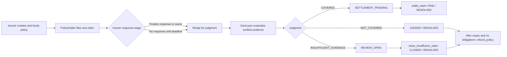

# COVER

COVER is a GenLayer-powered insurance claims court for AI agent failures. Insurers create policies and lock GEN to fund a fixed compensation amount. Each policy protects one designated policyholder against specified failures of one insured AI agent. The policyholder can submit one claim, and GenLayer independently evaluates the verified evidence against the policy conditions and exclusions. The contract then controls eligibility, accounting, settlement, and refunds deterministically.

- **Insurers** create and fully fund policies.
- **Policyholders** submit claims for alleged covered incidents.
- **GenLayer** evaluates verified evidence and returns a bounded judgment.
- **The contract** controls the beneficiary, amount, reserves, liabilities, and state transitions.

## Overview

AI agents can act quickly and across systems, while the responsibility for an unauthorized or harmful action may be difficult to assess. COVER provides a bounded claims process for specified agent failures. The policy terms, fixed compensation, stored wallets, deadlines, and evidence commitments are recorded onchain. Semantic adjudication is performed through GenLayer consensus, but AI does not choose who gets paid or how much.

The current implementation is designed for simulated incident records. Netlify-hosted JSON fixtures provide test evidence; they do not authenticate real-world incidents or prove that a reported loss occurred.

## How COVER Works

1. **Create and fund a policy.** The insurer names the policyholder and insured agent, writes coverage conditions and exclusions, selects a fixed compensation amount, chooses a positive duration of no more than 366 days, and sends exactly that amount in native GEN. The policy becomes active immediately.
2. **File a claim.** The stored policyholder can file one claim while the policy is active. The claimed incident time must fall within the policy period, must not be in the future, and the policy must not have expired at filing time.
3. **Respond or waive.** The insurer can submit one response with counterevidence, explicitly finalize that response, or waive the response opportunity. Finalization or waiver makes judgment immediately eligible. If the insurer is silent, a participant must wait for the three-day response deadline; silence is never approval.
4. **Evaluate the claim.** The leader and validators independently retrieve and verify the committed evidence, bind the claimant evidence to the insured agent, and evaluate authorization, causation, coverage conditions, exclusions, conflicts, and sufficiency.
5. **Apply the judgment.** The contract records `COVERED`, `NOT_COVERED`, or `INSUFFICIENT_EVIDENCE`. A covered judgment creates a fixed compensation liability; a rejected judgment pays nothing; an insufficient-evidence judgment opens a bounded review period.
6. **Settle or refund.** `settle_claim` pays the stored policyholder for a covered claim. An unresolved claim can be closed after its three-day review period, and unused reserves become refundable to the insurer only after the policy expires and all claim and liability obligations have ended.

## Lifecycle Diagram



## GenLayer Consensus

Before nondeterministic execution, `adjudicate_claim` snapshots the immutable policy conditions, exclusions, insured-agent identifier, claim data, insurer response, and both URL/hash commitments. The nondeterministic path does not mutate financial storage or emit transfers.

The leader and each validator independently run the same substantive proposal:

1. Fetch claimant evidence and, when submitted, insurer counterevidence with `gl.nondet.web.get`.
2. Require bounded successful responses, reject changed response URLs, verify raw-byte SHA-256 commitments, decode UTF-8, reject duplicate JSON keys and non-standard JSON constants, and accept only bounded JSON objects.
3. Require the claimant evidence's top-level `insured_agent` to exactly match the policy's stored identifier. Known `original_instruction.agent` and record-level `agent` or `actor` references must not be invalid or contradictory.
4. Provide only verified evidence to the semantic prompt. The prompt treats claimant, insurer, and fetched records as untrusted data and asks whether an unauthorized action, causal covered loss, applicable conditions, or exclusion is established.
5. Return a strictly bounded outcome and reason code. Validators compare their independently produced outcome, reason code, and evidence-status digest with the leader's result.

An explicit agent mismatch becomes `NOT_COVERED` with `UNAUTHORIZED_ACTION_NOT_ESTABLISHED`. Missing, malformed, or contradictory identity becomes `INSUFFICIENT_EVIDENCE`. A failed fetch, malformed model response, or consensus disagreement cannot become an approval.

## Deterministic Enforcement

The contract, rather than the semantic evaluator, controls:

- insurer and policyholder authorization;
- policy IDs, claim IDs, state transitions, and deadlines;
- exact GEN funding and the policy reserve;
- the immutable insured-agent identifier and policy terms;
- the fixed compensation amount and stored policyholder beneficiary;
- outstanding liability and reserve movement;
- duplicate-claim, duplicate-settlement, and duplicate-refund prevention; and
- settlement and refund eligibility.

For `COVERED`, the fixed compensation moves from `reserve_remaining` to `outstanding_liability`, and the claim enters `SETTLEMENT_PENDING`. `settle_claim` uses the stored policyholder and the stored liability, clears the liability, marks the claim `PAID`, and resolves the policy before emitting the transfer. `NOT_COVERED` records a judged claim without compensation. `INSUFFICIENT_EVIDENCE` keeps the reserve locked through the review window; `close_insufficient_claim` closes the claim without paying it.

Refunds are insurer-only. The policy must have expired, must not have been refunded already, must have no open response, ready, review, or settlement-pending obligation, and must have zero outstanding liability. The remaining reserve is zeroed before the refund transfer is emitted.

## Evidence

The contract accepts Netlify-hosted JSON as its external case-evidence source. Claim and counterevidence URLs must be HTTPS subdomains of `*.netlify.app`, and each submitted commitment must be a lowercase 64-character SHA-256 digest. The contract limits fetched response bodies to 4,096 bytes, requires a successful 2xx response, rejects redirects, verifies the exact raw response bytes before parsing, and rejects invalid UTF-8, malformed JSON, duplicate keys, non-standard JSON numbers, and non-object JSON roots.

The frontend can fetch the same URL and generate the digest automatically, but that check does not replace the contract's independent consensus-time fetch. A matching SHA-256 proves that the fetched bytes match the committed bytes. It does not prove who published the Netlify document, that the incident occurred, that the claimant-supplied timestamp is accurate, or that the claimed loss is genuine. Fetched fields, party statements, and prompt content remain untrusted input.

## Smart Contract

The authoritative implementation is [`contracts/cover.py`](contracts/cover.py). It uses scalar counters and typed `TreeMap` storage; it does not use `DynArray` storage. The source is pinned to:

```text
py-genlayer:5jycge4q8k23462jtb0b9fyey1s9qz928sz2nbrd9mg4sxqg2qng
```

### Public interface

Views:

- `get_config()` — protocol bounds, verdicts, states, evidence limit, and runner.
- `get_policy_count()` — number of created policies.
- `get_claim_count()` — number of created claims.
- `get_policy(policy_id)` — policy parties, terms, times, reserves, liability, status, claim link, and refund flag.
- `get_claim(claim_id)` — claim description, incident time, evidence commitments, response state, judgment, review state, and settlement attempts.

Writes:

- `create_policy(policyholder, insured_agent_id, coverage_conditions, exclusions, compensation_amount, duration_seconds)` — payable policy creation and exact funding.
- `file_claim(policy_id, incident_description, incident_time, evidence_url, evidence_sha256)` — policyholder-only claim filing.
- `submit_insurer_response(claim_id, response, counterevidence_url, counterevidence_sha256)` — one insurer response and counterevidence commitment.
- `finalize_insurer_response(claim_id)` — explicit insurer finalization.
- `waive_insurer_response(claim_id)` — explicit insurer waiver.
- `adjudicate_claim(claim_id)` — participant-triggered judgment after response completion or deadline.
- `submit_review_evidence(claim_id, evidence_url, evidence_sha256)` — one policyholder-only review evidence commitment with a distinct hash.
- `submit_review_response(claim_id, response, counterevidence_url, counterevidence_sha256)` — one insurer review response and counterevidence commitment.
- `finalize_review_response(claim_id)` — explicit insurer finalization of the review response.
- `waive_review_response(claim_id)` — insurer waiver of the review response opportunity.
- `reconsider_claim(claim_id)` — one participant-triggered independent reconsideration during the bounded review period.
- `close_insufficient_claim(claim_id)` — participant-triggered closure after the review window and, when applicable, the fixed 24-hour grace period.
- `settle_claim(claim_id)` — fixed-amount settlement for a covered claim.
- `refund_policy(policy_id)` — insurer-only refund of an eligible unused reserve.

`get_config()` exposes policy states `ACTIVE`, `REVIEW`, `RESOLVED`, and `REFUNDED`; claim states `RESPONSE_OPEN`, `READY_FOR_JUDGMENT`, `SETTLEMENT_PENDING`, `REVIEW_OPEN`, `JUDGED`, `PAID`, and `CLOSED`; and verdicts `COVERED`, `NOT_COVERED`, and `INSUFFICIENT_EVIDENCE`.

For the full field-level interface and lifecycle details, see [`docs/COVER_CONTRACT.md`](docs/COVER_CONTRACT.md). The security review and unresolved execution risks are documented in [`docs/COVER_AUDIT.md`](docs/COVER_AUDIT.md).

## Frontend

The frontend in [`frontend/`](frontend/) is a React and TypeScript application built with TanStack Start/Router, Vite, Tailwind CSS, GenLayer's transaction packages, and Bun. It supports wallet connection and Studio Next network switching, policy and claim explorers, insurer and policyholder workflows, accepted-state reads, transaction review, automatic Netlify evidence hashing, and policy/claim detail views.

The frontend reads onchain policy and claim data from the deployed contract. It does not use local storage or mock records as an authoritative source.

## Deployment and Local Development

The current COVER V3 deployment is on GenLayer Studio Next:

```text
Network:  GenLayer Studio Next
Chain ID: 61997
RPC:      https://studio-next.genlayer.com/api
Contract: 0x0982ebee0aA80Ed50c51903186ae5765e06879d8
```

The frontend is intended for hosting on Vercel. This repository does not claim a deployed Vercel URL and does not include a Vercel deployment configuration. The verified application build is `bun run build` from `frontend/`; configure the hosting project from the existing frontend package and verify its framework settings before deployment.

Use the safe example environment file:

```text
VITE_GENLAYER_RPC_URL=https://studio-next.genlayer.com/api
VITE_GENLAYER_CHAIN_ID=61997
VITE_COVER_CONTRACT_ADDRESS=0x0982ebee0aA80Ed50c51903186ae5765e06879d8
```

Do not commit `frontend/.env` or wallet credentials. From the repository root:

```bash
cd frontend
bun install --frozen-lockfile
bun run dev
```

The local development server uses the Vite configuration in `frontend/vite.config.ts`. Restart it after changing Vite environment variables.

## Testing

The repository separates static/host checks from GenLayer runtime testing:

```bash
# From the repository root
python3 -B -c 'import ast; ast.parse(open("contracts/cover.py", encoding="utf-8").read())'
pytest tests/unit -q
pytest tests/direct -q
genvm-lint check contracts/cover.py

# From frontend/
bun run typecheck
bun run lint
bun run test
bun run build
```

The local fixtures cover covered, excluded, insufficient, conflicting, malformed, altered, and prompt-injection cases. Direct tests use host-simulated web and model responses; they do not prove genuine validator agreement or final GEN transfer behavior.

The verified COVER successful-claim test followed this path:

- a policy was funded with 1 GEN;
- the submitted evidence identified the matching insured agent;
- simulated incident evidence was committed through a Netlify JSON fixture;
- the frontend generated the raw-byte SHA-256 commitment automatically;
- the insurer waived its response;
- GenLayer returned `COVERED`;
- the contract processed deterministic settlement; and
- the policyholder confirmed receiving the 1 GEN compensation.

This confirms the successful-claim path only. It does not claim that every negative outcome, validator-runtime scenario, or transfer-failure scenario was live-tested.

## Limitations

- Netlify fixtures are simulated evidence. Hash verification provides content integrity, not real-world authenticity, authorship, or proof of loss.
- The incident timestamp is a claimant-supplied value constrained by the policy window; the contract cannot independently establish when a real incident occurred.
- The pinned runner archive may be unavailable in local validation environments, and host tests do not replace genuine Studio Next consensus testing.
- `emit_transfer` does not expose a synchronous transfer result to the contract. The application must distinguish accepted transactions from finalized execution and must not treat acceptance alone as proof that GEN was received. If a runtime preserves state while an emitted transfer later fails, COVER cannot repair that outcome inside the contract; this remains an execution limitation documented in the audit.
- COVER is a bounded prototype for configured Studio Next testing. It is not presented as a licensed insurance company or as a production-ready insurance product.
